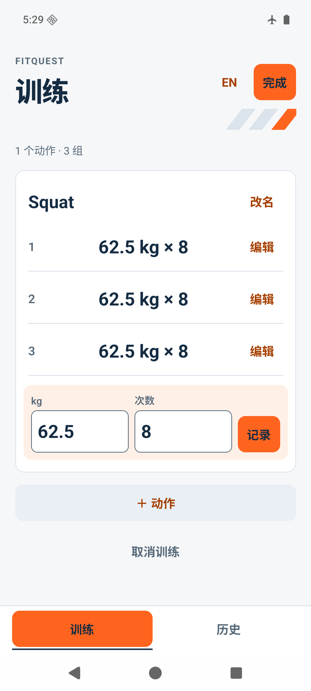
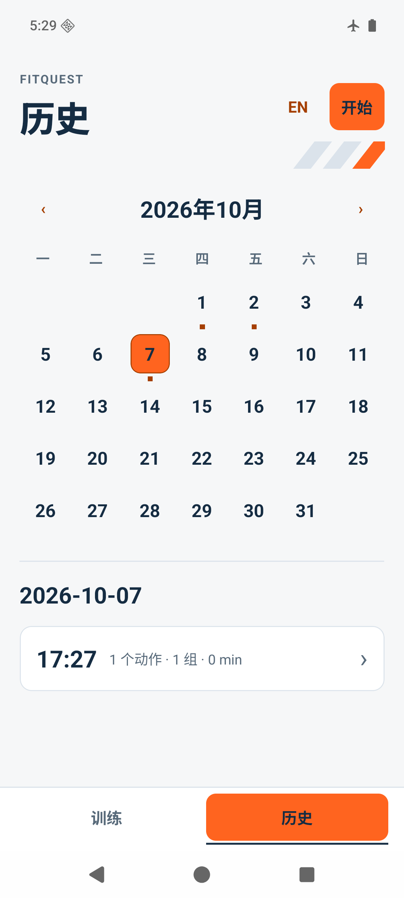
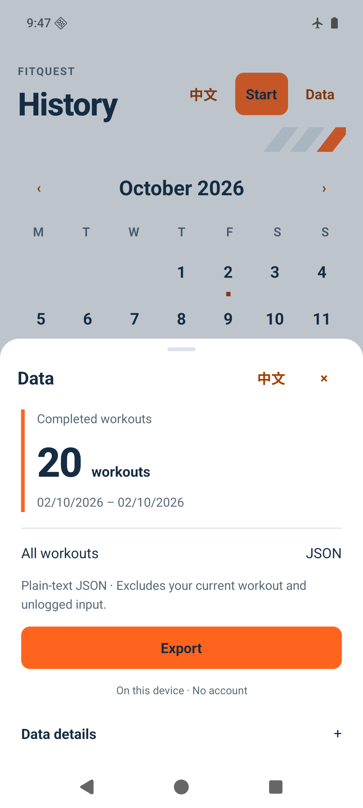

# FitQuest / Workout Tool

This repository is the working root for turning the original Workout Tool
portfolio project into a production-oriented mobile fitness app.

## Product direction

- **Primary target:** an Expo + React Native app for iOS and Android.
- **Development method:** specification-driven development with explicit
  requirements, acceptance criteria, tests, verification, and review.
- **Learning goal:** every feature must include a short explanation of the
  concepts, important files, data flow, and verification method.

## Current state

2026-10-14: fixed a late sharing-availability result reporting an error after cancellation. Seven regression cases bring the suite to 188/25. Fresh type/lint, both JS/Hermes exports and Android build pass. New test APK `1ee63b686078` was exercised for write failure, direct retry, local JSON reception and return; the existing synthetic databases stayed unchanged. Interface and dependencies are unchanged. See [latest evidence](specs/002-local-data-control/verification.md). iPhone and remaining acceptance are still open.

2026-10-13: Android validation now covers the approved Data sheet, native JSON reception by a local test app, system cancellation/return and repeat export. Chinese/English sheets were observed at 320dp with 130% font. The existing synthetic training data is preserved. A reproducible 1,000-workout desktop export benchmark is included; it does not establish phone performance. Physical iPhone, screen-reader, user/privacy and remaining interruption cases are still open. See [current evidence](specs/002-local-data-control/verification.md).

2026-10-12: the owner approved the History Data entry, bottom sheet and JSON export flow. The real app now exports all completed workouts through a consistent SQLite snapshot and native system sharing; empty history disables export, and returning from the system stays in the sheet without claiming delivery. Fresh 181 tests / 25 suites, type/lint, iOS/Android JS/Hermes exports and the Android test build pass. New local APK `1f3ed5f3ba3d` is arm64 with a debug signature; native sharing, iPhone, accessibility and user/privacy acceptance remain pending. B visuals are unchanged. See [002 verification](specs/002-local-data-control/verification.md) and [device validation steps](specs/002-local-data-control/quickstart.md).

2026-10-07: the owner chose B, now implemented as bright orange / ink navy / mist-white real UI. Local candidate `f3b396b26936` has fresh 153-test, type/lint, export/build checks and targeted synthetic 320dp/130% font/save/reopen evidence. The owner confirmed the current type size, palette and density. iPhone acceptance remains pending. See [dated verification](specs/001-workout-session-loop/verification.md). The following native scenarios retain their original 2026-10-02 build scope.

### Confirmed App preview

Real Android runtime screenshots from a Mac emulator, using synthetic data. Chinese and English share the same training data and interactions; physical iPhone acceptance is still pending.

| Training | Calendar history |
| --- | --- |
|  |  |

[English training](docs/design/screenshots/2026-10-07/training-en.png) · [English history](docs/design/screenshots/2026-10-07/history-en.png) · [Design decisions](docs/design/FRONTEND_REVIEW.md)

| Data sheet · Chinese | Data sheet · English |
| --- | --- |
|  |  |

These are actual Android screenshots of APK `1f3ed5f3ba3d`, using 20 synthetic workouts. The export receiver used for validation is a separate local diagnostic app, not a cloud destination.

### Run the mobile app

Use Node.js 24 and npm 11, then:

```bash
cd apps/mobile
npm ci
npm run test:ci
npm run typecheck
npm run lint
npm start
```

See [mobile setup and limitations](apps/mobile/README.md). Historical `/Users/...` links in audit notes refer to the original development machine; they are not downloadable repository assets.

### Earlier implementation evidence

- `legacy/streamlit/` contains the recovered original Streamlit application.
- `.agents/skills/` contains the canonical project quality skills.
- `.cursor/skills/` exposes the same skills to Cursor without duplicating them.
- `.cursor/rules/` contains persistent Cursor workflow rules.
- GitHub Spec Kit is initialized under `.specify/` with Codex skills mode.
- `specs/001-workout-session-loop/` contains the approved first mobile feature
  specification, technical design artifacts and 33 implementation tasks (including the bilingual amendment).
- `apps/mobile/` connects Expo routes to bilingual workout entry, correction,
  confirmed save, saved summaries and calendar history with confirmed deletion.
  The shared provider and SQLite flow pass 153 Jest tests in 19 suites, including
  real Router + desktop SQLite integration. Type/lint, both JS/Hermes exports,
  and the latest Android arm64 build/signature/ZIP-alignment checks pass.
  The 2026-10-02 local APK was `4f6c66316bf5` (release variant, debug signature,
  temporary package `dev.fitquest.local`). Its independently reviewed targeted Android observation shows
  Loading while a save owns storage, no false read error, no late navigation after
  leaving, and correct offline reopen. Existing synthetic rows remain unchanged.
  The prior `044ab329e9e4` APK separately passed the late-save navigation scenario.
  Earlier Q001–Q007/Q009, 20-cycle persistence, locale/320 dp keyboard and 16 KB
  evidence remain bound to their respective builds; they were not all rerun on 4f6.
  Disabling 16 KB compatibility mode was not verified.
  On the earlier `00aba5737eab` APK, the 1000-workout calendar/detail/scroll/back
  path was independently observed. First-window P95 was 298 ms across five starts;
  this does not measure full UI readiness. Slow frames were retained, and the
  software-rendered emulator does not establish real-device smoothness.
  Q008 remains partial: narrow-calendar design, actual screen-reader use,
  physical devices, iOS and privacy/user validation are pending.
  See [mobile README](apps/mobile/README.md) for versioned artifacts and commands,
  and [tasks](specs/001-workout-session-loop/tasks.md) for the current task state.
  T032 running/learning documents are complete; owner mastery requires demonstration.
  Expo Doctor's same-day 21/21 result applies to unchanged dependencies;
  audit remains open with 15 findings. This is not store readiness.
- Frontend work requires multiple user confirmation rounds, tracked in
  `docs/design/FRONTEND_REVIEW.md` (light/orange, inline set entry, bottom Train/History navigation and calendar date-to-detail interaction accepted; automatic keyboard dismissal and Finish/Delete flows accepted; core co-design complete, visual richness deferred, narrow-calendar choice and full accessibility validation pending).

The Streamlit application is preserved as product and domain reference. It is
not the target architecture for the mobile app.

## Current planning documents

- [`docs/product/DELIVERY_ROADMAP_2026-09-23.md`](docs/product/DELIVERY_ROADMAP_2026-09-23.md)
  estimates remaining milestones, effort, calendar time, cash and maintenance costs,
  with a staged validation and monetization plan. New scope and platform/capacity
  scenarios are proposals, not approvals or release-date promises.

- [`docs/product/PLATFORM_DECISION_2026-09-12.md`](docs/product/PLATFORM_DECISION_2026-09-12.md)
  compares current platform fees, estimated effort, revenue scenarios and why
  the current implementation proceeds with a local-first App.

- [`docs/product/PRODUCT_AND_DELIVERY_PLAN.md`](docs/product/PRODUCT_AND_DELIVERY_PLAN.md)
  defines the draft product strategy, MVP boundary, business hypotheses,
  validation gates, technical direction, and staged delivery roadmap.
- [`docs/learning/AI_PRODUCT_MANAGER_PATH.md`](docs/learning/AI_PRODUCT_MANAGER_PATH.md)
  defines the learning outcomes and the single-agent collaboration protocol.
- [`docs/learning/MOBILE_TECH_STACK_FOUNDATIONS.md`](docs/learning/MOBILE_TECH_STACK_FOUNDATIONS.md)
  explains the mobile stack, FitQuest data flow, official learning references,
  and mastery exercises for a first-time Expo and React Native learner.
- [`docs/product/DECISIONS.md`](docs/product/DECISIONS.md) records approved
  product decisions and the evidence that can trigger a future review.
- [`.specify/memory/constitution.md`](.specify/memory/constitution.md) defines
  the non-negotiable product, learning, privacy, and engineering principles.
- [`docs/research/INTERVIEW_GUIDE.md`](docs/research/INTERVIEW_GUIDE.md) and the
  adjacent templates support the first 12 problem-discovery interviews.

The product direction was approved by the product owner on 2026-08-02. These
documents are planning inputs, not substitutes for future Spec Kit feature
specifications.

## Planned structure

```text
apps/
  mobile/              # Expo routes, training UI and local SQLite storage
legacy/
  streamlit/           # Original portfolio implementation
specs/                 # Feature specifications and acceptance criteria
docs/
  product/             # Vision, users, roadmap
  architecture/        # Architecture and decisions
  learning/            # Learning notes tied to features
```

Continue from `specs/002-local-data-control/tasks.md` and the remaining acceptance
items in `specs/001-workout-session-loop/tasks.md`. Training/save/history/delete and
the approved Data sheet/JSON export are implemented. Remaining device, accessibility,
usability and privacy evidence is required before final acceptance. Native links are restricted to known paths;
the upstream URL-decoder dependency advisory remains open.
